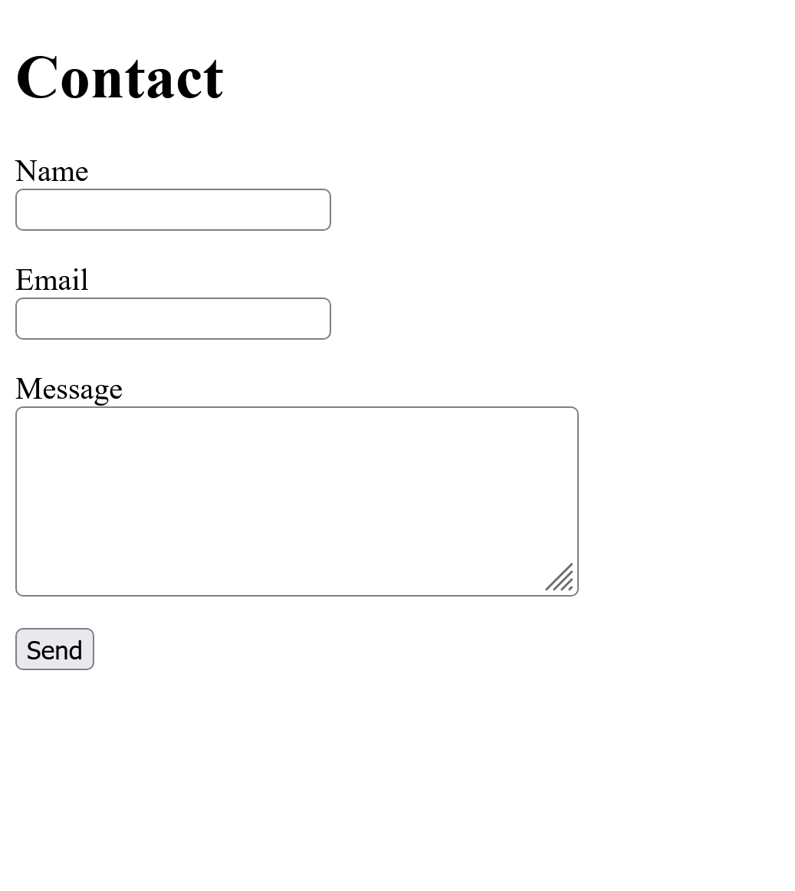
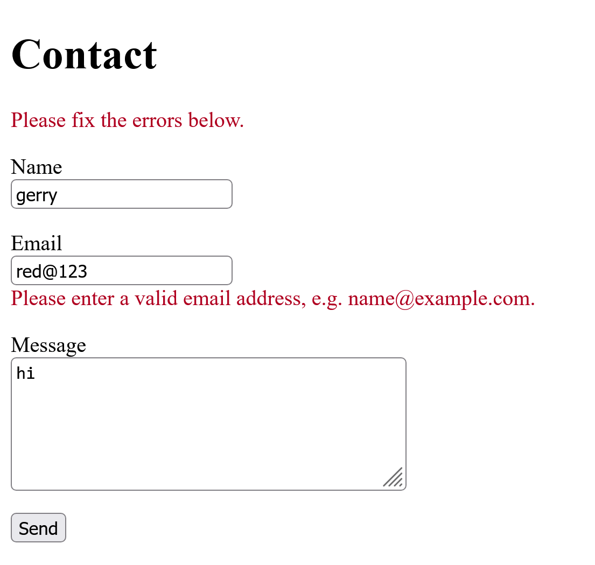
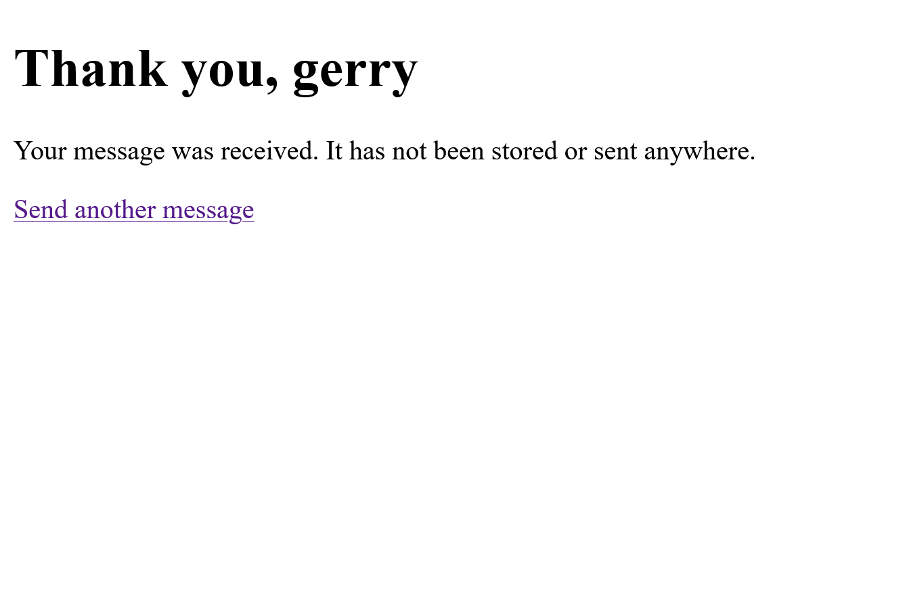
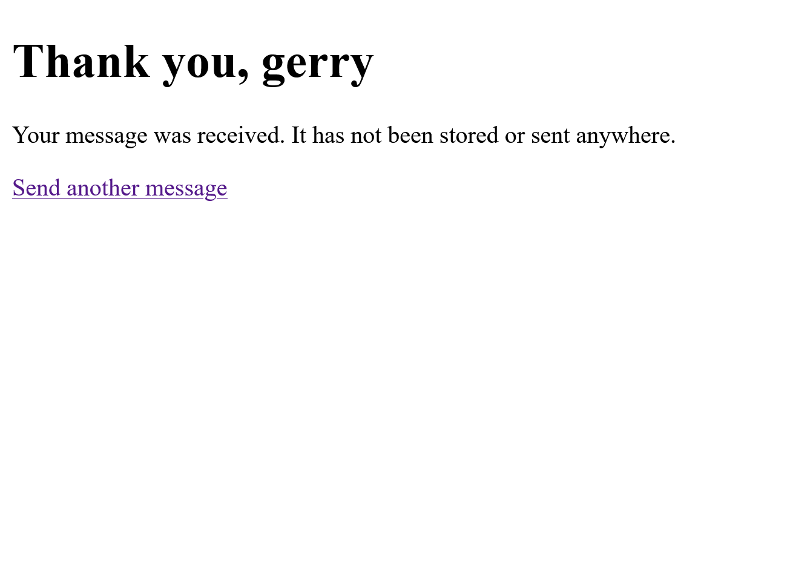
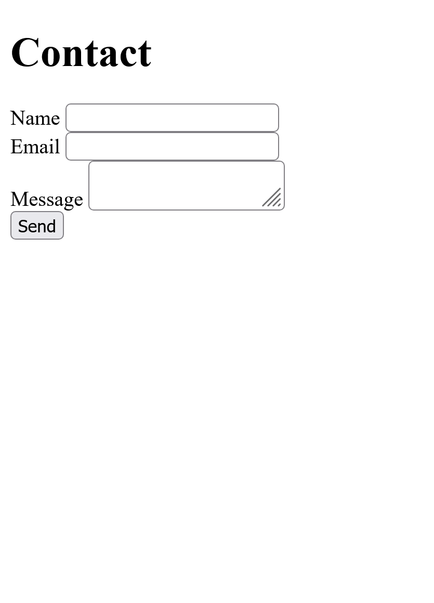
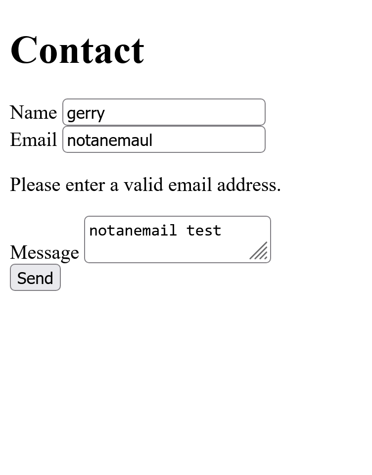
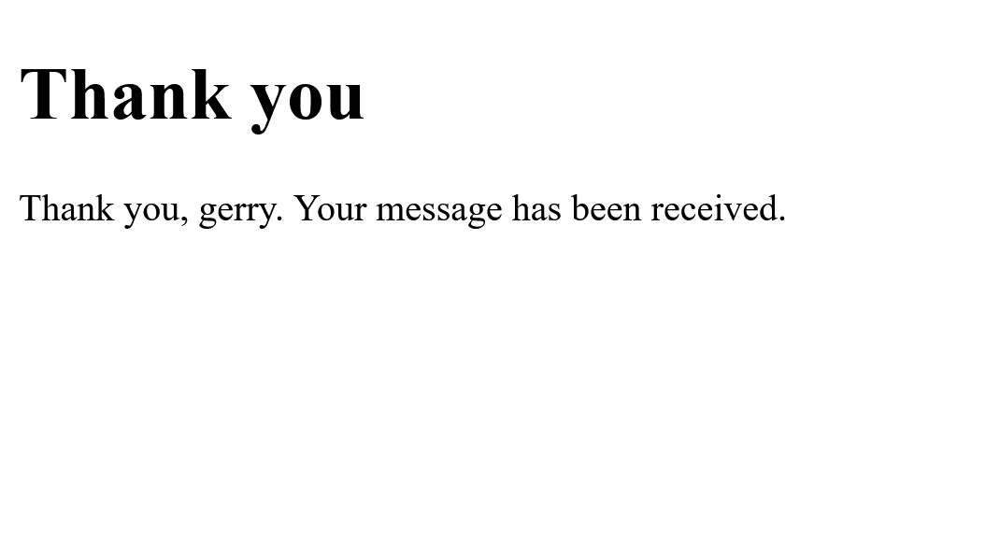

# Week 2 - AI Tool Comparison

I compared contact-form code from ChatGPT and Claude. Both assistants were given the same detailed prompt, and I saved both outputs exactly as they were first generated, without follow-up prompts or edits.

## The requirement

Add a contact form to my Flask application. It must:

- render at `/contact` with fields for name, email and message
- validate that the email address is well-formed server side
- reject empty name or message fields with a visible error
- on success, show a confirmation page
- store nothing yet (persistence comes in Week 5)

## What I compared

| Version | Location |
|---|---|
| ChatGPT | `experiments/week02/chatgpt-winner/` (`app.py`, `requirements.txt`, `templates/contact.html`, `templates/contact_success.html`) |
| Claude | `experiments/week02/claude/` (`app.py`, `templates/contact.html`, `templates/contact_confirmation.html`) |

Both are Flask applications built on top of my existing home (`/`) and About (`/about`) pages. Both kept those pages unchanged.

## Prompt used

The same prompt was given to both assistants:

```text
I have a small Flask application. Environment: Python 3.15.0, Flask 3.1.3,
Werkzeug 3.1.9, Jinja2 3.1.6, MarkupSafe 3.0.4, running locally on Windows.

Task: add a contact form.

Requirements:
1. GET /contact renders a form with fields: name, email, message.
2. POST /contact validates on the server:
   - name must not be empty or only whitespace
   - message must not be empty or only whitespace
   - email must be well-formed
3. If validation fails, re-display the form with a visible error message
   for each failing field, and keep what the user typed.
4. If validation passes, show a separate confirmation page.
5. Do not store the submission anywhere: no database, no file, no email.

Constraints:
- Use only Flask and the Python standard library. Do not add any packages
  (no Flask-WTF, no email-validator).
- Use Jinja2 templates in templates/ for the new pages only.
- Any user input shown back on the page must be escaped.
- Do not change, remove or reformat any existing code, including the
  ABOUT_TEXT variable and the existing app.run() line.
- Do not hard-code any secrets.
- Only use functions you are certain exist in these versions; tell me if you are unsure.
```

Because the prompt and starting code were identical, the differences below come from the assistants themselves. This is still only one task and one attempt each, so it doesn't show that one assistant is always better than the other.

## How each version validates the email

The two versions take different approaches:

- **ChatGPT** uses a regular expression (`re`) that lists exactly which characters are allowed (a *whitelist*). It strips stray spaces first, caps the address at 254 characters, and uses `fullmatch` so the whole address must match the pattern.
- **Claude** uses `email.utils.parseaddr` plus a series of manual checks that reject specific bad patterns (a *blacklist*). Anything not explicitly rejected is allowed through.

Both run in Python on the server, so both meet the "server side" requirement.

## Scores and evidence

| Criterion (1-5) | ChatGPT | Claude |
|---|---|---|
| **Correctness** | **4.5** - Rejected every malformed address in my tests and returns HTTP 400 when validation fails. Only gap: the part before the `@` isn't limited to 64 characters. | **3** - Accepted 4 malformed addresses (`a@exa_mple.com`, `a@1.2`, `x@domain.123` and a 254+ character address) and wrongly rejected a valid address with a trailing space. Returns HTTP 200 on failure. |
| **Code quality** | **4.5** - Validation is in its own function that returns a dictionary of errors, so it is easy to test. The regex is commented. Templates use `url_for()` and an accessible error summary. | **3** - Name and message checks are written inline in the route. The email function is dense and partly repeats itself. `parseaddr` is designed for reading email headers, not validating addresses. Templates hard-code `/contact`, and `aria-describedby` points to error elements that may not exist. |
| **Completeness** | **5** - Meets all five requirements and includes a `requirements.txt`. The confirmation page states that nothing was stored and links back to the form. | **4.5** - Meets all five requirements, but has no `requirements.txt`, no link back from the confirmation page, and passes the name to the confirmation page without trimming spaces. |
| **Security** | **4** - Server-side checks can't be bypassed, output is escaped, the length check runs before the regex, and the regex isn't vulnerable to catastrophic backtracking. | **3.5** - Output is escaped and checks run on the server, but there is no length limit on the email, and `parseaddr` has a known misparsing issue (CVE-2023-27043) that could matter once data is stored in Week 5. |
| **Total /20** | **18** | **14** |

Neither version has CSRF protection, length limits on the name and message, or debug mode turned off. These are shared gaps and are acceptable for a local beginner lab, but they will need fixing before the app is deployed or starts storing data.

## Checks and results

### Email validation tests

I ran both email checks against the same set of addresses:

| Input | ChatGPT | Claude | Correct result |
|---|---|---|---|
| `gerry@tideclockshop.com` | accept | accept | accept |
| `a@exa_mple.com` | reject | **accept** | reject (underscore not allowed in a domain) |
| `a@1.2` | reject | **accept** | reject |
| `x@domain.123` | reject | **accept** | reject (ending can't be all numbers) |
| `gerry@x.ie ` (trailing space) | accept | **reject** | accept |
| `seán@example.ie` | reject | accept | debatable (valid, but rarely used) |
| Address over 254 characters | reject | **accept** | reject |
| 65 characters before the `@` | **accept** | **accept** | reject (both miss this) |
| `a..b@x.com`, `a@-x.com`, `a@x`, `@x.com`, `a@@x.com`, `Gerry <g@x.ie>`, empty | reject | reject | reject |

### Whole-form tests

I also ran each application with its own templates and submitted the form:

| Test | ChatGPT | Claude |
|---|---|---|
| `/contact` loads | 200 | 200 |
| All fields empty: three errors shown | yes (HTTP 400) | yes (HTTP 200) |
| Bad email: error shown and typed values kept | yes | yes |
| `<script>alert(1)</script>` as name: shown as harmless text | yes | yes |
| Valid submission: confirmation page | yes | yes |

### Bypassing browser validation

ChatGPT's form uses `novalidate`, with a comment explaining why. This turns off the browser's own email check, so every submission reaches Flask and the server-side check is what actually gets tested. When I submitted a bad email, the terminal logged `POST /contact HTTP/1.1" 400`, which shows the request reached the server and Python rejected it.

Claude's form uses `type="text"` for the email field, so the browser doesn't check it either. However, phones won't show the email keyboard.

## Screenshots

### ChatGPT

**1. The contact form.** Labels sit above each field, and the message box is large.



**2. Invalid email and preserved input.** The address `red@123` is rejected with a red error under the field. A red "Please fix the errors below" summary appears at the top, and the name and message are kept.



**3. Successful submission.** A separate confirmation page explains that the message was not stored or sent, and links back to the form.



**4. Script test submitted.** A submission containing `<script>alert(1)</script>` was accepted and reached the confirmation page with no popup. The confirmation page does not display the message, so this screenshot shows the submission was accepted, not how the script text was displayed. The escaping is covered by the whole-form test above.



### Claude

**1. The contact form.** Labels sit beside the fields, and the message box is small, so the layout looks cramped.



**2. Invalid email and preserved input.** The address `notanemaul` is rejected and the typed values are kept, but the error appears as plain black text, so it is easy to miss.



**3. Script test submitted.** As with ChatGPT, the submission was accepted and the confirmation page appeared with no popup. The page shows the name, not the message, and there is no link back to the form.



These images show the visible behaviour. The tests above provide the evidence for HTTP status codes, escaping, and validation when the browser check is bypassed.

## What each version got wrong

### ChatGPT

- The part of the email before the `@` isn't limited to 64 characters, as the email standard requires.
- Non-ASCII addresses such as `seán@example.ie` are rejected. The code comment says this is deliberate, so it is a design choice rather than a bug.
- The form is plain, with no styling beyond the red errors.

### Claude

- The email check lets through malformed addresses (`a@exa_mple.com`, `a@1.2`, `x@domain.123`) and has no length limit.
- A valid address with a trailing space, which phones often add, is rejected.
- A failed submission returns HTTP 200 instead of 400.
- Error messages are plain black text and don't stand out.
- The labels are squashed beside the fields, so the form is poorly laid out.
- The email field is `type="text"`, so phones don't show the email keyboard.
- The form action is hard-coded as `/contact` instead of using `url_for()`.
- The confirmation page has no link back to the form.
- No `requirements.txt` was provided.

## Which I kept, and why

I kept the **ChatGPT** version. It meets all five requirements, and its email check rejected every malformed address in my tests except the 64-character case. It also returns the correct HTTP 400 status when validation fails.

It also has a better user experience:

- Errors are red, with a "Please fix the errors below" summary at the top.
- It uses `novalidate`, with a comment explaining why, so the server-side check is what gets tested.
- It keeps `type="email"`, so phones show the email keyboard.
- It uses `url_for('contact')` instead of a hard-coded `/contact`.
- The confirmation page says the message has not been stored or sent, and links back to the form.

ChatGPT's `app.py` contained my original home and About code unchanged, with the contact form added. Merging it was therefore a matter of copying `app.py` and its `templates/` folder into the root of my project. I checked that `/`, `/about` and `/contact` all still worked before committing.

My choice is based on how well the code meets the assignment and how it behaved in testing, not on the name of the assistant.

## What surprised me

Both forms looked like they rejected bad emails, but the tests showed that Claude's check let several malformed addresses through. A form that looks right in the browser isn't proof that the validation is right.

I also learned that the browser can do its own email check before anything reaches the server. If that happens, a broken server check would go unnoticed. ChatGPT's use of `novalidate` made sure the server check was the one being tested.

Finally, I first thought that seeing `<script>alert(1)</script>` on the page was a fault. It is actually the correct result: the text is displayed safely instead of being run as code. The fault would be a popup appearing.

## Files I saved

- `experiments/week02/chatgpt-winner/`: the original ChatGPT output, unedited.
- `experiments/week02/claude/`: the original Claude output, unedited.
- `app.py` and `templates/` at the project root: the ChatGPT version, merged into my application.
- `experiments/docs/images/`: the screenshots used in this report.
- `experiments/docs/week02-tool-comparison.md`: this report.
